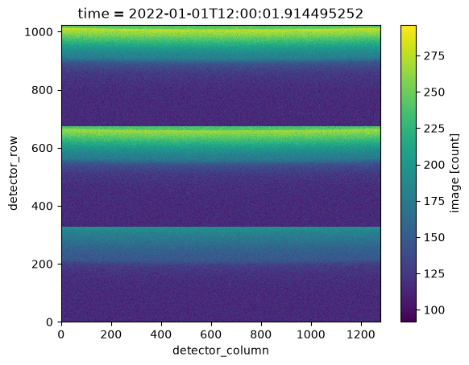
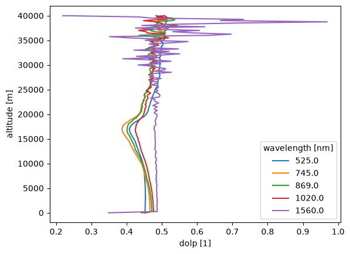
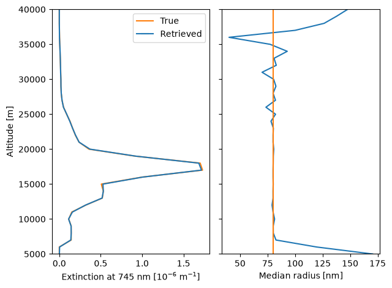

(_ali_quickstart)=
# Quickstart

## Running the simulator
`ALISimulator` runs from the atmosphere to the retrieved aerosol extinction and particle size.  The
default atmosphere has no aerosol, so here the `omps_calipso_era5` atmosphere supplies it, from an
OMPS-LP curtain:

```{code-block} python
import matplotlib.pyplot as plt
import pandas as pd

from hawcsimulator.ali import ALISimulator

simulator = ALISimulator()

input = {
        "tangent_latitude": 30.0,
        "tangent_longitude": 0.0,
        "tangent_solar_zenith_angle": 60.0,
        "tangent_solar_azimuth_angle": 120.0,
        "time": pd.Timestamp("2022-01-01T12:00:00Z"),
        "l2_cfg": {"minimizer": {"verbose": 0}},
}

data = simulator.run(
    ["calibration_database", "l1a", "l1b", "l2", "l2_truth"],
    input,
    config={"atmosphere_method": "omps_calipso_era5"},
)
```

`run` returns the outputs you ask for; any intermediate product of the simulation can be requested,
see [the ALI simulator](introduction.md).  The instrument's spectral channels are in the
calibration database:

```{code-block} python
print(data["calibration_database"]["center_wavelength"].to_numpy())
```

## The L1A frames
`l1a` is an `xarray.DataTree` with one detector frame per exposure: one for each spectral channel,
then a blank frame (`spectral_channel` -1).  The three polarization sub-images are stacked
vertically on the detector:

```{code-block} python
l1a = data["l1a"].to_dataset()
print(l1a["spectral_channel"].to_numpy())

l1a["image"].isel(time=1).plot()
```



## The L1B radiance and polarization
`l1b` holds radiance, Stokes parameters and degree of linear polarization on an altitude grid, for
each observation set, across-track bin and channel:

```{code-block} python
cell = data["l1b"].isel(observation_set=0, across_track=data["l1b"].sizes["across_track"] // 2)

plt.figure()
cell["dolp"].sel(altitude=slice(0, 40000)).plot.line(y="altitude", hue="wavelength")
```



## The retrieved profile
The L2 retrieval runs in two stages.  The first fits from 5 to 40 km and looks for clouds; the second
fits from above any cloud it finds, starting from the first stage's result.  `l2` is an L2 granule
in aliprocessing's L2 format, along `observation_set`, `across_track` and `altitude`; by default it
holds one profile, the first observation set's middle across-track bin.  It has the retrieved
`aerosol_extinction` and `aerosol_median_radius` with their noise and solution errors, priors and
averaging kernels, the `surface_albedo`, the cloud diagnostics (`cloud_top_altitude`, ...), the
first stage's extinction (`aerosol_extinction_stage1`), and the altitudes the second stage fitted
(`lower_altitude_limit`, `upper_altitude_limit`).  `l2_truth` is the true aerosol extinction,
median radius and surface albedo on the same grid, with the same names, so the retrieval error is
`l2 - l2_truth`:

```{code-block} python
l2 = data["l2"].isel(observation_set=0, across_track=0)
lower = float(l2["lower_altitude_limit"])
retrieved = l2.sel(altitude=slice(lower, 40000))
truth = data["l2_truth"].isel(observation_set=0, across_track=0).sel(altitude=slice(lower, 40000))

fig, (ax1, ax2) = plt.subplots(1, 2, sharey=True)
ax1.errorbar(
    retrieved["aerosol_extinction"] * 1e6,
    retrieved["altitude"],
    xerr=retrieved["aerosol_extinction_noise_error"] * 1e6,
    label="Retrieved",
)
ax1.plot(truth["aerosol_extinction"] * 1e6, truth["altitude"], label="True")
ax1.set_xlabel("Extinction at 745 nm [10$^{-6}$ m$^{-1}$]")
ax1.set_ylabel("Altitude [m]")
ax1.legend()
ax2.plot(retrieved["aerosol_median_radius"], retrieved["altitude"])
ax2.plot(truth["aerosol_median_radius"], truth["altitude"])
ax2.set_xlabel("Median radius [nm]")
ax1.set_ylim(lower, 40000)
fig.tight_layout()
```



## Changing the simulation
The simulation is configured through the input:

```{code-block} python
input = {
        "tangent_latitude": 30.0,
        "tangent_longitude": 0.0,
        "tangent_solar_zenith_angle": 60.0,
        "tangent_solar_azimuth_angle": 120.0,
        "time": pd.Timestamp("2022-01-01T12:00:00Z"),
        # The instrument definition, processing version and acquisition pattern
        # (these are the defaults)
        "instrument": "ALI-0-FWHEEL-REP1",
        "processing": "v0.1",
        "acquisition": "nominal",
        # Overrides of the instrument definition's aliprocessing.cal_db.SimpleInstrument fields
        "cal_db_cfg": {"center_wavelengths_nm": (525.0, 745.0, 1020.0)},
        # Two observation sets with the boresight at 26 km, frames of 0.5 s
        "acquisition_cfg": {
            "pointing": {"boresight_tangent_altitude_m": 26000.0},
            "timing": {"num_sets": 2, "exposure": 0.5},
        },
        # No detector noise; {"seed": 1} gives a reproducible noise realization
        "l1a_cfg": {"noise": False},
        # Retrieve every across-track bin of the second observation set
        "l1b_image_cfg": {"observation_set": 1, "across_track": "all"},
        # Overrides of the retrieval configuration
        "l2_cfg": {"minimizer": {"verbose": 0}, "two_stage": {"enabled": False}},
}

data = simulator.run(["l2"], input, config={"atmosphere_method": "omps_calipso_era5"})
```

See [Instruments, Processing Versions and Acquisition Patterns](../instruments.md) for the instrument definitions and
processing versions.  The default viewing tangent altitudes, -3 to 56 km, cover the instrument's
field of view; if you change them they still have to cover the L1B altitude grid.  Inputs the simulator does not use, or
that name a computed product, raise an error rather than being ignored.
