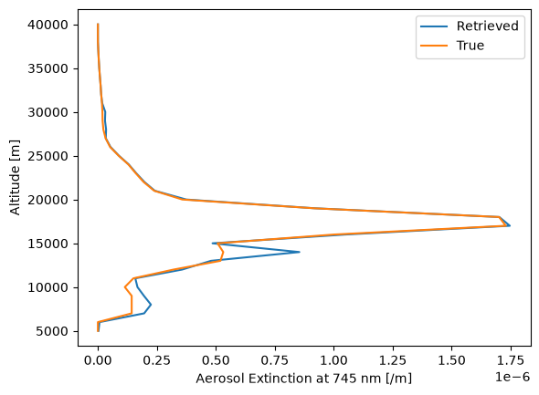
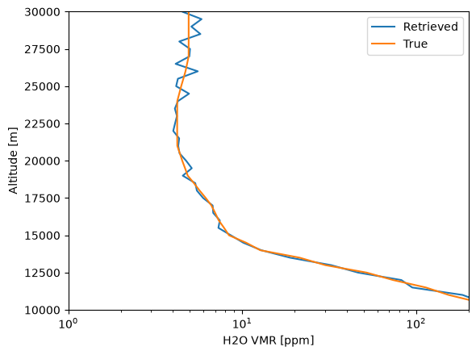

---
---

(_quickstart)=
# HAWCsat Simulator Package

```{important}
Version 2026.11.0 made significant changes to the instrument models and the API of this package.
The SHOW and ALI simulators are now built on the instrument models and processing of `showlib` and
`aliprocessing`, and their inputs and outputs have changed: code written for earlier versions needs
updating, and its results will differ.  See the [changelog](changelog.md) for the details.
```

The `hawcsimulator` package simulates the ALI and SHOW instruments planned for the HAWCsat
satellite, end to end: the atmosphere, the radiance at the instrument (SASKTRAN2), the instrument
model's detector data (L1A), the calibrated L1B, and the L2 retrievals, with the instrument models
and processing of [`aliprocessing`](https://github.com/usask-arg/ali-processing) and
[`showlib`](https://github.com/usask-arg/show-lib).  By default the simulators use the current
representative instruments, processing and acquisition; the others are listed in
[Instruments, Processing Versions and Acquisition Patterns](instruments.md).

This page is a quickstart.  It assumes you have installed `hawcsimulator`; see
[Installation](installation.md).  Each instrument also has its own quickstart and a page of
options: [SHOW](show/quickstart.md) and [ALI](ali/quickstart.md).

## Environment/IDE Setup
Installation through `uv` will have created a Python virtual environment inside the folder.
If you know what that means and have a Python IDE installed, feel free to use that.  Otherwise
we can use a jupyter notebook for the rest of this guide:

    uv add jupyter
    uv run jupyter notebook

A web browser should have opened up.  Create a new Python3 notebook and open it up.

## ALI Example
A simple ALI retrieval can be performed through,

```{code-block} python
from hawcsimulator.ali import ALISimulator

import pandas as pd
import matplotlib.pyplot as plt

simulator = ALISimulator()

input = {
        "tangent_latitude": 30.0,
        "tangent_longitude": 0.0,
        "tangent_solar_zenith_angle": 60.0,
        "tangent_solar_azimuth_angle": 0.0,
        "time": pd.Timestamp("2022-01-01T12:00:00Z")
}

data = simulator.run(["l2", "l2_truth"], input, config={"atmosphere_method": "omps_calipso_era5"})

# The L2 granule holds one profile here: the first observation set's middle across-track bin.
# l2_truth is the true state on the same grid.  The retrieval fits measurements from
# lower_altitude_limit (5 km, or above any cloud) to 40 km
l2 = data["l2"].isel(observation_set=0, across_track=0)
truth = data["l2_truth"].isel(observation_set=0, across_track=0)
lower = float(l2["lower_altitude_limit"])
fitted = slice(lower, 40000)

plt.plot(l2["aerosol_extinction"].sel(altitude=fitted), l2["altitude"].sel(altitude=fitted), label="Retrieved")
plt.plot(truth["aerosol_extinction"].sel(altitude=fitted), truth["altitude"].sel(altitude=fitted), label="True")
plt.xlabel("Aerosol Extinction at 745 nm [/m]")
plt.ylabel("Altitude [m]")
plt.legend()
```

The simulation includes the instrument: the radiance is turned into detector frames (L1A) with
shot, read and quantization noise, processed to L1B, and retrieved.  Add `"l1a_cfg": {"noise": False}`
to the input for a noise-free simulation.  See [the ALI simulator](ali/introduction.md) for the other options.



## SHOW Example
A simple SHOW retrieval can be performed through,

```{code-block} python
from hawcsimulator.show import SHOWSimulator
import pandas as pd
import matplotlib.pyplot as plt

simulator = SHOWSimulator()

input = {
        "tangent_latitude": 30.0,
        "tangent_longitude": 0.0,
        "tangent_solar_zenith_angle": 60.0,
        "tangent_solar_azimuth_angle": 0.0,
        "time": pd.Timestamp("2022-01-01T12:00:00Z"),
}

data = simulator.run(["l2", "l2_truth"], input, config={"atmosphere_method": "omps_calipso_era5"})

# l2_truth is the true state on the L2's grid, so the retrieval error is l2 - l2_truth
l2 = data["l2"].ds.isel(time=0)
truth = data["l2_truth"].isel(time=0)

plt.plot(l2["h2o_vmr"] * 1e6, l2["altitude"], label="Retrieved")
plt.plot(truth["h2o_vmr"] * 1e6, truth["altitude"], label="True")
plt.ylim(10000, 30000)
plt.xlim(1, 200)
plt.xscale("log")
plt.xlabel("H2O VMR [ppm]")
plt.ylabel("Altitude [m]")
plt.legend()
```
Here the SHOW interferograms (L1A) are simulated with noise, processed to L1B spectra, and retrieved.
The first run of an instrument also builds and caches the retrieval's line shapes, which later runs
load.  See [the SHOW simulator](show/introduction.md) for the other options.



## Observation geometry
The lines of sight are a vertical scan from one observer, built as ECEF rays: one per viewing
tangent altitude, in the vertical plane through the tangent point at `tangent_latitude`,
`tangent_longitude` and 25 km.  They look along `los_azimuth` at the tangent point (degrees
clockwise from north, default 0), or towards the tangent point from `observer_latitude` and
`observer_longitude` when those are given, and the observer is where that line of sight reaches
the instrument's orbit altitude.  `tangent_solar_zenith_angle` and `tangent_solar_azimuth_angle`
(relative to the line of sight, 0 is forward scatter) set the solar angles at every tangent point;
without them the sun's position at `time` is used.

## Using Orbital Parameters
TBD: simulating observations along the HAWCsat orbit is being added in a separate change.

## Manually specifying the atmospheric state
The previous examples use the option `config={"atmosphere_method": "omps_calipso_era5"}` which loads in atmosphere data
from an example curtain of OMPS-LP stratospheric aerosol extinction, CALIPSO cloud height, and ERA5 water vapour profiles.
Here we run the SHOW simulator where we use the same atmosphere, but we override the water vapour profile,

```{code-block} python
import sasktran2 as sk

h2o = sk.climatology.mipas.constituent("H2O", sk.optical.HITRANAbsorber("H2O"))

h2o.vmr[20] *= 5
plt.plot(h2o.vmr, h2o.altitudes_m)
plt.xscale("log")

input = {
        "tangent_latitude": 30.0,
        "tangent_longitude": 0.0,
        "tangent_solar_zenith_angle": 60.0,
        "tangent_solar_azimuth_angle": 0.0,
        "time": pd.Timestamp("2022-01-01T12:00:00Z"),
        "constituents": {"h2o": h2o}, # NEW LINE
}

data = simulator.run(["l2", "l2_truth"], input, config={"atmosphere_method": "omps_calipso_era5"})

l2 = data["l2"].ds.isel(time=0)
truth = data["l2_truth"].isel(time=0)

plt.figure()
plt.plot(l2["h2o_vmr"] * 1e6, l2["altitude"], label="Retrieved")
plt.plot(truth["h2o_vmr"] * 1e6, truth["altitude"], label="True")
plt.ylim(10000, 30000)
plt.xlim(1, 200)
plt.xscale("log")
plt.xlabel("H2O VMR [ppm]")
plt.ylabel("Altitude [m]")
plt.legend()
```

```{toctree}
:maxdepth: 4
:hidden:
:caption: For Users

installation
changelog
```

```{toctree}
:maxdepth: 4
:hidden:
:caption: The SHOW Simulator

show/quickstart.md
show/introduction.md
```

```{toctree}
:maxdepth: 4
:hidden:
:caption: The ALI Simulator

ali/quickstart.md
ali/introduction.md
```

```{toctree}
:maxdepth: 4
:hidden:
:caption: API Reference

instruments.md
api/steps.md
api/datacontainers.md
```

```{toctree}
:maxdepth: 4
:hidden:
:caption: For Developers

developer/local_setup.md
developer/contributing.md
```
