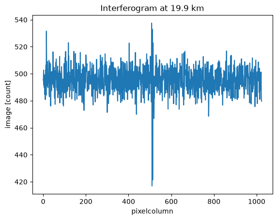
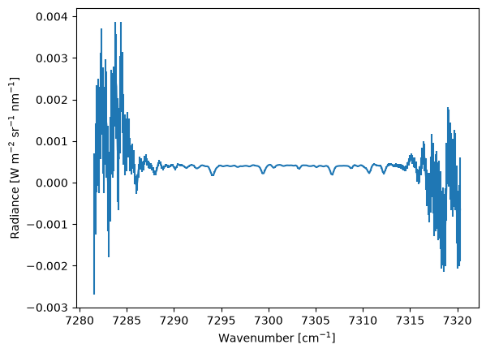
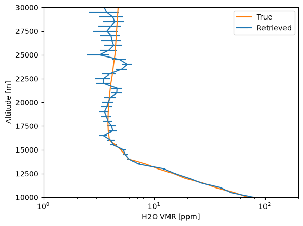

(_show_quickstart)=
# Quickstart

## Running the simulator
`SHOWSimulator` runs from the atmosphere to the retrieved water vapour profile.  The default
atmosphere includes the MIPAS standard water vapour profile, so a run only needs the observation:

```{code-block} python
import matplotlib.pyplot as plt
import numpy as np
import pandas as pd

from hawcsimulator.show import SHOWSimulator

simulator = SHOWSimulator()

input = {
        "tangent_latitude": 30.0,
        "tangent_longitude": 0.0,
        "tangent_solar_zenith_angle": 60.0,
        "tangent_solar_azimuth_angle": 0.0,
        "time": pd.Timestamp("2022-01-01T12:00:00Z"),
        "l2_cfg": {"engine": {"num_threads": 4}},
}

data = simulator.run(["l1a", "l1b", "l2", "l2_truth"], input)
```

`run` returns the outputs you ask for; any intermediate product of the simulation can be requested,
see [the SHOW simulator](introduction.md).  The default instrument, `SHOW-0-SHS-REP1`, has 200
lines of sight, so a run takes several minutes and up to about 16 GB of memory; fewer lines of sight
are faster (see [Changing the simulation](#show_changing_the_simulation)).

## The L1A interferograms
Each detector row is one line of sight.  `l1a` is a `showlib.l1a.data.L1ADataSet`, and its `ds`
holds the detector image in counts:

```{code-block} python
l1a = data["l1a"].ds.isel(time=0)
row = int(np.abs(l1a["tangent_altitude"] - 20000.0).argmin())

l1a["image"].isel(los=row).plot()
plt.title(f"Interferogram at {float(l1a['tangent_altitude'][row]) / 1000:.1f} km")
```



## The L1B spectra
`l1b` is a `showlib.l1b.data.L1bDataSet` with the radiance spectrum of each line of sight:

```{code-block} python
l1b = data["l1b"].ds.isel(time=0, los=row)

plt.figure()
plt.errorbar(l1b["wavenumber"], l1b["radiance"], l1b["radiance_noise"])
plt.xlabel("Wavenumber [cm$^{-1}$]")
plt.ylabel("Radiance [W m$^{-2}$ sr$^{-1}$ nm$^{-1}$]")
```



## The retrieved profile
`l2` is a `showlib.l2.data.L2DataSet`, an L2 granule in showlib's L2 format.  Its `ds` holds, along
`time` and `altitude`, `h2o_vmr` with its noise error `h2o_vmr_noise_error` and solution error
`h2o_vmr_solution_error`, the prior `h2o_vmr_prior`, the `h2o_vmr_averaging_kernel` and the
retrieved aerosol.  `l2_truth` is the true `h2o_vmr` on the same grid, so the retrieval error is
`l2.ds - l2_truth`:

```{code-block} python
l2 = data["l2"].ds.isel(time=0).sel(altitude=slice(10000, 30000))
truth = data["l2_truth"].isel(time=0).sel(altitude=slice(10000, 30000))

plt.figure()
plt.errorbar(l2["h2o_vmr"] * 1e6, l2["altitude"], xerr=l2["h2o_vmr_noise_error"] * 1e6, label="Retrieved")
plt.plot(truth["h2o_vmr"] * 1e6, truth["altitude"], label="True")
plt.ylim(10000, 30000)
plt.xlim(1, 200)
plt.xscale("log")
plt.xlabel("H2O VMR [ppm]")
plt.ylabel("Altitude [m]")
plt.legend()
```



(show_changing_the_simulation)=
## Changing the simulation
The simulation is configured through the input:

```{code-block} python
input = {
        "tangent_latitude": 30.0,
        "tangent_longitude": 0.0,
        "tangent_solar_zenith_angle": 60.0,
        "tangent_solar_azimuth_angle": 0.0,
        "time": pd.Timestamp("2022-01-01T12:00:00Z"),
        # The instrument definition, processing version and acquisition pattern
        # (these are the defaults)
        "instrument": "SHOW-0-SHS-REP1",
        "processing": "v0.1",
        "acquisition": "nominal",
        # Integrate each image for 4 s rather than 2 s
        "acquisition_cfg": {"timing": {"integration_time_s": 4.0}},
        # Overrides of the instrument definition's calibration database settings
        "cal_db_cfg": {"fringe_visibility": 0.9},
        # No detector noise; {"seed": 1} gives a reproducible noise realization
        "l1a_cfg": {"noise": False},
        # A rectangular rather than Kaiser apodization window
        "l1b_cfg": {"apodization": None},
        # Overrides of the retrieval configuration
        "l2_cfg": {"engine": {"num_threads": 4}, "observation": {"upper_bound_m": 40000}},
}

# One detector row per line of sight, here 61 from 5 to 35 km rather than the instrument's 200
data = simulator.run(
    ["l2"],
    input,
    overrides={"viewing_tangent_altitudes": np.arange(5000.0, 35001.0, 500.0)},
)
```

See [Instruments, Processing Versions and Acquisition Patterns](../instruments.md) for the instrument definitions and
processing versions.  Computed products such as the lines of sight above are replaced with
`overrides`; a calibration database of your own, `overrides={"calibration_database": cal_db}`,
needs one row per viewing tangent altitude.  Inputs the simulator does not use, or that name a
computed product, raise an error rather than being ignored.
